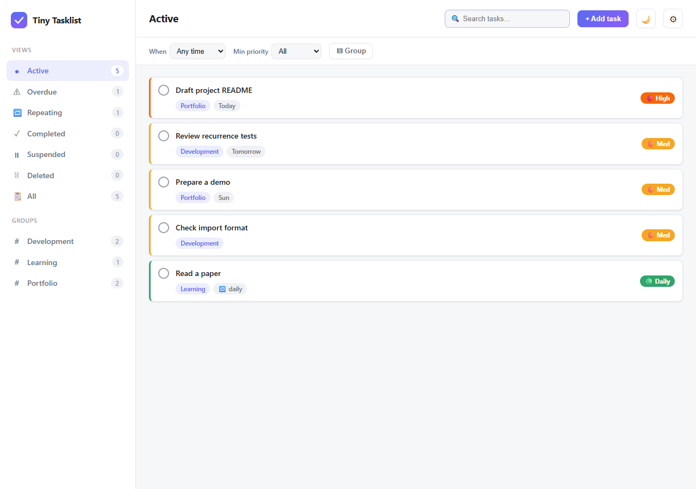

# Tiny Tasklist

Tiny Tasklist is a small task and habit manager that runs on your own computer and opens in your browser. One-off tasks and repeating habits share one list with due dates, priorities, groups and notes; repeating tasks roll forward when their day passes and keep a completion history for streaks; a plain-text import turns a pasted list into tasks. Everything is stored in a local SQLite file. The program is Python 3.13 standard library only, with nothing to install.



## Try it without installing

Open `web/index.html` in a browser. It runs on built-in sample tasks: edits stay in memory, and only `today`, `tomorrow`, `+Nd` and `YYYY-MM-DD` are understood as due values.

## Run

Requires Python 3.13 or newer. From the repository root:

```sh
python -m tasklistprogram
```

Then open `http://127.0.0.1:8000`. The server listens on this machine only (loopback). `--port N` changes the port; `--data-dir DIR` uses another store.

## Where data lives

`tasklistprogram/data/tasks.db` (SQLite), next to a `.bak` of the previous state and dated JSON snapshots under `backups/`; git ignores all of it. Set `TINYTASKLIST_DATA_DIR` or pass `--data-dir` to move it.

## Documentation

- [User guide](docs/USER_GUIDE.md)
- [Import format](docs/IMPORTING.md)
- [Architecture and API](docs/ARCHITECTURE.md)
- [Known issues](docs/KNOWN_ISSUES.md) and [changelog](docs/CHANGELOG.md)
- [Provenance](PROVENANCE.md): what this edition contains and where it comes from

## Tests

```sh
python -m unittest discover -s tests
```

If Node is installed, the suite also checks that `web/app.js` parses.

## License

MIT, see [LICENSE](LICENSE).
