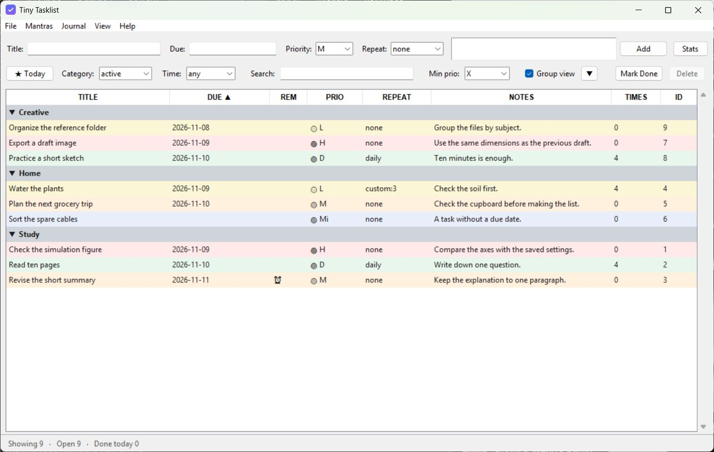

# Tiny Tasklist

A Python/Tkinter desktop app for tasks and repeating habits. It has due dates,
priorities, groups, bulk edits and reminder checkpoints. Task notes and daily
journals are Markdown files; tasks are stored in SQLite.

See the [project page](site/index.html) and [user guide](docs/USER_GUIDE.md).



*Desktop app with invented tasks.*

## Run the desktop app

Requires Python 3.13 or newer with Tkinter. No extra Python packages are needed.
From the repository root:

```sh
python -m tasklistprogram
```

- Add tasks with flexible dates such as `tomorrow 14:00` or `+2d`.
- Sort and group the list; select several rows to change their dates, priorities
  or groups together.
- Complete a recurring task to record it and advance its next occurrence.
- Open a task's Markdown notes or add an entry to the daily journal.

## Optional browser prototype

The browser prototype uses the same task store and date parser:

```sh
python -m tasklistprogram.webserver
```

Then open `http://127.0.0.1:8000`. The server listens on this machine only (loopback). `--port N` changes the port; `--data-dir DIR` uses another store.

For a sample-data demo, open `web/index.html` or use `?demo=1` when serving it over
HTTP. Changes are not saved. Demo dates accept only `today`, `tomorrow`, `+Nd` and
`YYYY-MM-DD`; demo imports use titles only. The browser does not include the
desktop's journals, task documents, reminders or bulk edits.

## Where data lives

`tasklistprogram/data/tasks.db` stores tasks. The previous state is saved as
`tasks_gui.json.bak`, with dated JSON snapshots under `backups/`. Git ignores these
files. Set `TINYTASKLIST_DATA_DIR`, or pass `--data-dir` to the browser server,
to use another folder.
The desktop also uses that folder for `task_documents/`, `journals/` and
`mantras.md`. Set the environment variable before starting the app.

## Documentation

- [Project page](site/index.html): build its local assets with `python scripts/build_site.py`, then open `site/index.html`. The resulting `site/` folder can be served on its own.
- [User guide](docs/USER_GUIDE.md)
- [Import format](docs/IMPORTING.md)
- [Architecture and API](docs/ARCHITECTURE.md)
- [Known issues](docs/KNOWN_ISSUES.md) and [changelog](docs/CHANGELOG.md)
- [Provenance](PROVENANCE.md)

## Tests

```sh
python -m unittest discover -s tests
```

If Node is installed, the suite also checks the browser scripts and error handling.

## License

MIT, see [LICENSE](LICENSE).
